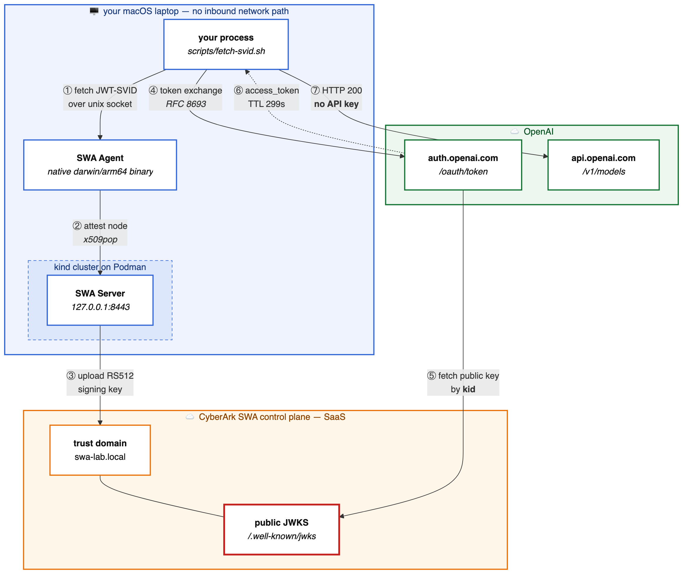
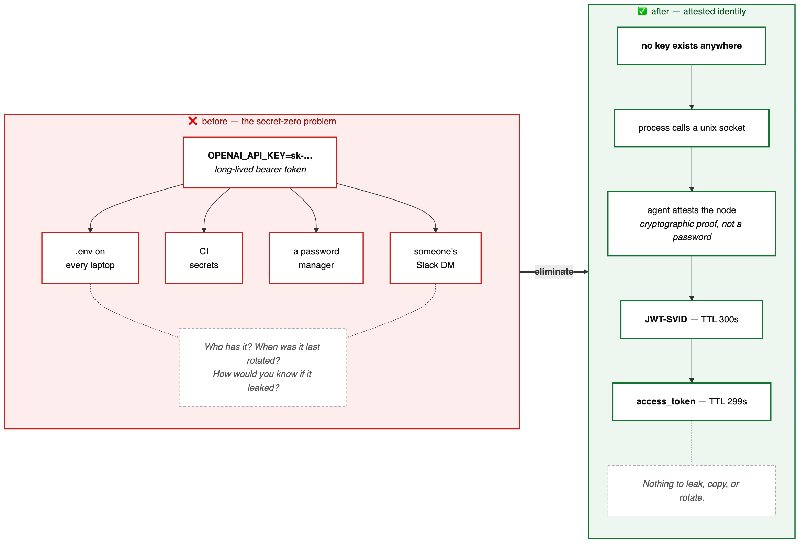
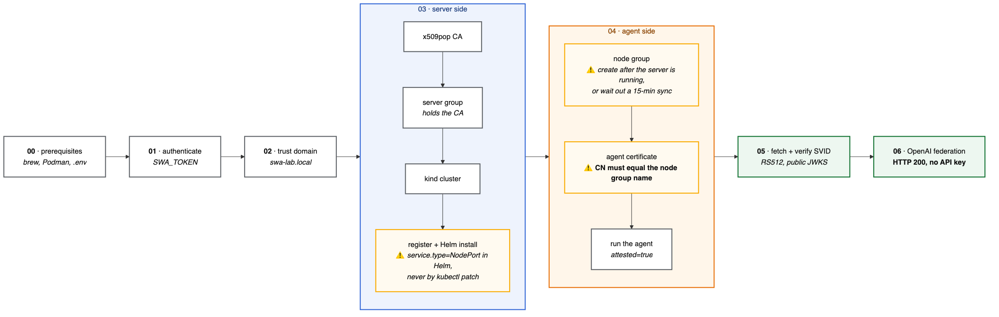

# Zero Secrets: SPIFFE → OpenAI with CyberArk Secure Workload Access

Call the OpenAI API from a macOS laptop with **no API key**. No `sk-…` string
exists at any point — not in a file, not in an environment variable, not in a
secrets manager.

Instead the workload proves *what it is* with a cryptographically attested SPIFFE
identity, and OpenAI exchanges that proof for a 5-minute access token.

Built as a hands-on workshop. **Every command was executed against a real
CyberArk tenant and a real OpenAI organization** — outputs are transcribed, not
invented, and where something is untested it says so.



---

## The problem: secret zero

Conventional API access begins with a long-lived key. It must be created, stored,
distributed, rotated, and revoked — and because it is a *bearer* credential,
anyone holding a copy is indistinguishable from the legitimate workload.

Protecting it with a secrets manager only moves the problem: now the workload
needs a credential to authenticate to the secrets manager. That irreducible first
credential is **secret zero**.



Workload identity federation dissolves it. The workload holds no secret at all.
It presents a short-lived, signed assertion of its own identity, issued by an
authority the API provider already trusts.

## Why this works on a laptop with no tunnel

**OpenAI never connects to your laptop.**

Because Secure Workload Access is a SaaS control plane, the JWKS lives on a public
CyberArk URL, and OpenAI fetches keys from there. Your laptop only ever makes
outbound calls.

So there is no ngrok, no tunnel, no port forwarding, no public DNS, and no
uploaded JWKS blob anywhere in this workshop. A self-hosted SPIRE server on a
laptop *cannot* do this — you would have to expose its OIDC Discovery Provider to
the internet. Here the SaaS control plane is the public surface.


## What you need

| | |
|---|---|
| **Hardware** | Apple Silicon Mac (the release ships `darwin/arm64` and `amd64`) |
| **Entitlement** | A CyberArk tenant with Secure Workload Access, plus `swa-release-v1.0.2.tgz` from the Marketplace |
| **OpenAI** | **Organization owner** rights — members cannot see the Workload Identity Federation page at all |
| **Tooling** | Podman Desktop, `kind`, `helm`, `kubectl`, `jq`, `openssl`, `python3` |
| **Time** | Under 3 minutes of commands; 3–10 minutes of OpenAI console clicking |

Full detail, including the Kubernetes version constraint and the Gatekeeper
caveat, is in [docs/00-prerequisites.md](docs/00-prerequisites.md).

## Quick start

```bash
git clone <this repo> && cd spiffe-swa-openai
cp .env-template .env      # then fill in your tenant details
```

Then work through [`docs/`](docs/README.md) in order. Each document gates the next
— the ordering is not cosmetic, and two steps fail confusingly if taken early.



| # | Document | What it covers |
|---|---|---|
| 00 | [Prerequisites](docs/00-prerequisites.md) | Tooling, entitlements, `.env`, Apple Silicon caveats |
| 01 | [Authentication](docs/01-authentication.md) | Tenant auth — **the flow most examples get wrong** |
| 02 | [Trust domain](docs/02-trust-domain.md) | Trust domain, OIDC discovery, signing algorithm |
| 03 | [SWA Server on kind](docs/03-swa-server-kind.md) | Server group, x509pop CA, kind cluster, Helm install |
| 04 | [macOS agent](docs/04-macos-agent.md) | De-quarantine, node group, agent cert, run, attest |
| 05 | [Fetch and verify SVIDs](docs/05-fetch-svid.md) | Fetch JWT-SVIDs, verify RS512 against the public JWKS |
| 06 | [OpenAI federation](docs/06-openai-federation.md) | Console setup, token exchange, negative tests |
| 07 | [Troubleshooting](docs/07-troubleshooting.md) | Every failure hit while building this, with fixes |
| 08 | [Facilitator notes](docs/08-facilitator-notes.md) | Timings, pre-baking, teardown, demo script |

## Scripts

| Script | Purpose |
|---|---|
| `swa-auth.sh` | Authenticate to the tenant; exports `SWA_TOKEN`. **Source it** |
| `swa-api.sh` | `METHOD PATH [BODY]` wrapper with the two headers the API requires |
| `restart-agent.sh` | Stop, clear the socket, start **one** agent, verify attestation |
| `fetch-svid.sh` | Fetch a JWT-SVID for an audience (default: OpenAI) |
| `exchange-openai.sh` | Exchange an SVID for an OpenAI access token, then call the API |
| `verify-federation.sh` | The negative tests — run this one live |
| `teardown.sh` | Remove everything, innermost-first |

## Verified results

| Claim | Evidence |
|---|---|
| Agent attests natively on macOS — no container, no VM | `attested=true` in the agent log |
| SPIFFE ID issued from Unix identity | `spiffe://swa-lab.local/macos-unix-ng/workload/qcheng` |
| Token signed RS512, verifiable from the public JWKS | Signature verified against the published JWKS |
| **OpenAI accepts RS512** | Token exchange returned an access token |
| Authentication succeeds | `GET /v1/models` → **HTTP 200** |
| Access token is short-lived | `exp - iat` = **299 seconds** |
| Forged and tampered tokens are refused | 3 of 4 negative tests rejected |
| OpenAI records the attested identity | `wif_external_subject` = the SPIFFE ID, inside the access token |
| **No API key anywhere** | `grep -rE 'sk-(proj-)?[A-Za-z0-9]{20,}' docs/ scripts/` → no matches |

One thing does **not** work on the tenant used here: the final inference call
returns `You have no credits remaining`. That is a billing state reached only
*after* authentication succeeds — `GET /v1/models` returning 200 with no API key
is the claim being made, and it holds.

## The negative tests are the point

`scripts/verify-federation.sh`:

```
1. valid SVID, correct audience           ACCEPTED
2. wrong audience                         REJECTED: Invalid subject token.
3. tampered signature                     REJECTED: Invalid subject token.
4. forged token, key not in JWKS          REJECTED: Invalid subject token.
```

Test 4 is worth dwelling on. That token carries the right `sub`, the right `aud`,
the right `iss`, an unexpired `exp`, **and** the correct `identity_provider_id`
and `service_account_id`. It fails for exactly one reason: SWA did not sign it.

That is why those IDs can sit in a `.env` file and be projected on a wall.

## Security notes

**Nothing secret is committed.** `.gitignore` excludes `.env`, `artifacts/`, and
all `*.key` / `*.crt` / `*.cert` / `*.jwt` material. Verify before your first
push:

```bash
git status --short              # no .env, no artifacts/, no *.key
git ls-files | grep -E '\.(key|crt|cert|jwt)$|^\.env$'   # must be empty
```

**Do not commit the CyberArk release.** `swa-release-v1.0.2.tgz` and its unpacked
`swa-release-v1.0.2/` directory are licensed CyberArk software, 413 MB, and
already gitignored. Obtain it from the CyberArk Marketplace with your own
entitlement.

**Tenant identifiers are real, and are not credentials.** The host
`apj-secrets.secretsmgr.cyberark.cloud` and tenant ID `AAP4062` appear verbatim in
the docs so that every sample output is genuine. Neither grants access — but if
you fork this for a public audience, consider replacing them with your own, since
they do name a specific tenant.

**This is a lab, not a production pattern.** It uses `unix` workload attestation
with empty `workload_registration_policies`, so *every* process on the attested
node can obtain an identity. For real use, add CEL policies (e.g.
`unix.user == 'appuser'`) and prefer `k8s_psat` or a TPM over `x509pop`. See the
last section of [docs/08-facilitator-notes.md](docs/08-facilitator-notes.md).

## Diagrams

Sources are in [`docs/images/src/`](docs/images/src) as Mermaid `.mmd` files.
Regenerate after editing:

```bash
npx -y @mermaid-js/mermaid-cli@11 -i docs/images/src/01-architecture.mmd \
  -o docs/images/01-architecture.png -b white -s 3
```

## Versions

Verified 2026-08-04 against:

| Component | Version |
|---|---|
| SWA release | `v1.0.2` (agent/server `1.0.0-SNAPSHOT`) |
| Kubernetes (kind node) | `v1.35.5` — SWA supports 1.33–1.35 |
| Podman | 5.8.3 |
| Signing algorithm | RS512 / RSA_4096, `token_ttl` 300s |

Two things in the SWA 1.0.2 package are worth knowing before you start: the
native macOS agent binary **ships but is undocumented**, and the `docker`
workload attestor **crashes the agent** — use `unix`.

## Acknowledgements

Reference implementation for the VM/Ansible path:
[bnasslahsen/swa-demos](https://github.com/bnasslahsen/swa-demos).

## License

[Apache-2.0](LICENSE). CyberArk SWA binaries, images, and Helm charts are **not**
covered by this license and are not distributed here.
