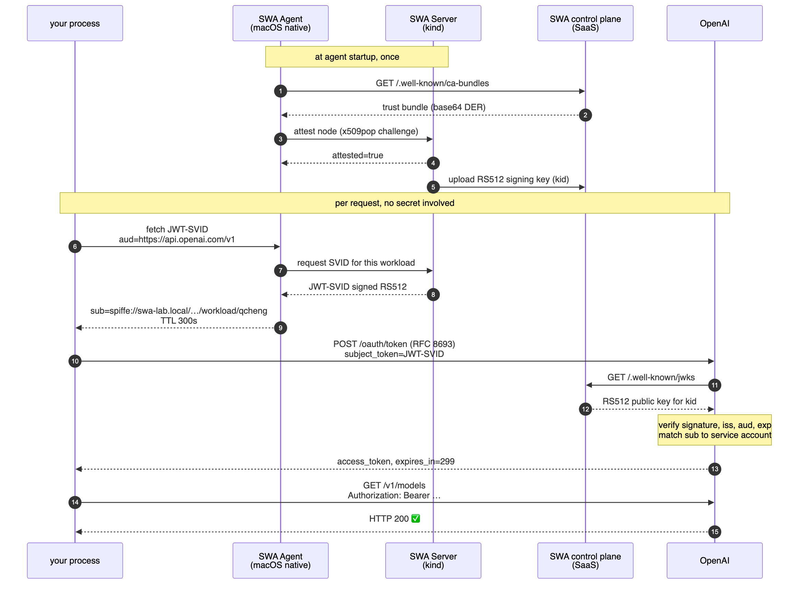

# 06 — OpenAI federation

Everything so far has been about minting an identity. This is where it buys
something: OpenAI trades the SPIFFE JWT-SVID for a short-lived access token.

No `OPENAI_API_KEY` is created, stored, or read at any point.

The whole exchange, end to end — note that every arrow from your laptop is
outbound, and OpenAI's only inbound fetch goes to CyberArk's public JWKS, never to
you:



## 1. Configure the identity provider

**Console** → your organization → **Settings** → **Security** → **Workload
Identity Federation** → **Add provider**.

You must be an **owner** of the OpenAI organization. Members cannot see this
page — check before the workshop, not during it.

| Field | Value |
|---|---|
| Issuer URL | `https://apj-secrets.secretsmgr.cyberark.cloud/api/swa/trust-domains/swa-lab.local` |
| Audience | `https://api.openai.com/v1` |
| Use uploaded JWKS | **disabled** |
| Mapping key | `sub` |
| Mapping value | `spiffe://swa-lab.local/macos-unix-ng/workload/qcheng` |

Four things worth getting right the first time.

**The issuer has no `.well-known` suffix.** It is the `iss` claim from
[05](05-fetch-svid.md), byte-for-byte. OpenAI appends
`/.well-known/openid-configuration` itself. Pasting the discovery URL from the
trust-domain creation response is the most common mistake here.

**Leave uploaded JWKS disabled.** Discovery mode means OpenAI fetches the public
key from CyberArk on demand, so key rotation needs no action from you. This only
works because the SWA control plane is SaaS — see
[README](README.md#the-insight-that-makes-this-work-on-a-laptop).

**The audience string is exact.** `https://api.openai.com/v1` — with the `/v1`,
without a trailing slash. It must match the `-a` argument in
`scripts/fetch-svid.sh`.

**The mapping value is your own SPIFFE ID.** It embeds your Unix username, so
`qcheng` above will be different for you. Get it from:

```bash
python3 -c 'import base64,json,sys;t=open("/tmp/svid-openai.jwt").read().strip().split(".")[1];print(json.loads(base64.urlsafe_b64decode(t+"="*(-len(t)%4)))["sub"])'
```

Copy that output verbatim. For a room of attendees, either give each their own
mapping, or standardise the Unix username used to run the agent.

## 2. Pick a project and service account

The provider maps an external identity onto an OpenAI **service account**, which
lives inside a **project**. So the identity provider tells OpenAI *who you are*;
the service account determines *what you may do and who pays*.

1. **Settings** → **Projects** → choose one (`Default` is fine for a lab), or
   create a project for the workshop so its usage and limits are isolated.
2. In the provider mapping dialog, select that project, then choose
   **Create new service account**. OpenAI creates it and shows a `user-...` ID.
   You do **not** need to generate an API key for it — that would defeat the
   purpose.
3. Record both IDs.

**One service account per provider mapping.** The `(identity_provider_id,
service_account_id)` pair must be unique; reusing a service account across two
providers is rejected.

## 3. Record the two IDs

```bash
# Append to .env — these are identifiers, not credentials
OPENAI_IDENTITY_PROVIDER_ID=idp_x09jLtJCQYRJduTu7ili4vHS
OPENAI_SERVICE_ACCOUNT_ID=user-6X0QghpjKz5khNfjKXSeqNdr
```

Both appear in the request body, and neither authorises anything on its own —
they name which provider and which service account to use. The proof that they
are not secrets is that the request also carries the JWT-SVID, and without a
valid SVID these two IDs get you nothing (test 4 in step 6 demonstrates this).

Note the prefixes: `idp_` for the identity provider, `user-` for the service
account. OpenAI's documentation shows `wip_...` and `svac_...` in examples; the
live console issues the forms above. Copy what your console shows.

## 4. Exchange the SVID for an access token

```bash
set -a; source .env; set +a
scripts/exchange-openai.sh
```

The `set -a` matters: a plain `source .env` assigns the variables in your shell
but does not **export** them, so the script sees nothing and stops with
`set OPENAI_IDENTITY_PROVIDER_ID`. (`scripts/swa-auth.sh` does the `set -a`
internally, so if you have already sourced that, `.env` is fully exported and you
can skip this.)

```
JWT-SVID sub: spiffe://swa-lab.local/macos-unix-ng/workload/qcheng
exchange OK: access_token acquired (1512 chars, short-lived)
```

The request underneath, an RFC 8693 token exchange:

```bash
curl -sS -X POST https://auth.openai.com/oauth/token \
  -H "Content-Type: application/json" \
  -d '{
    "grant_type": "urn:ietf:params:oauth:grant-type:token-exchange",
    "subject_token_type": "urn:ietf:params:oauth:token-type:jwt",
    "subject_token": "<the JWT-SVID>",
    "identity_provider_id": "idp_...",
    "service_account_id": "user-..."
  }'
```

Note the host: **`auth.openai.com`**, not `api.openai.com`.

## 5. Inspect what you were given

```bash
python3 - <<'PY'
import base64, json
t = open('/tmp/openai-access-token.txt').read().strip().split('.')[1]
c = json.loads(base64.urlsafe_b64decode(t + '=' * (-len(t) % 4)))
print(json.dumps({k: c[k] for k in c if k != 'https://api.openai.com/auth'}, indent=2))
print(json.dumps(c.get('https://api.openai.com/auth'), indent=2))
print("lifetime:", c['exp'] - c['iat'], "seconds")
PY
```

```json
{
  "iss": "https://auth.openai.com",
  "sub": "user-6X0QghpjKz5khNfjKXSeqNdr",
  "aud": "https://api.openai.com/v1",
  "iat": 1785834840,
  "nbf": 1785834840,
  "exp": 1785835139,
  "jti": "5cbf4b785da44636a51ba90cc1020b3b"
}
```

```json
{
  "user_id": "user-6X0QghpjKz5khNfjKXSeqNdr",
  "organization_id": "org-hxtb895q3vE0Ej4UiOGTmRNM",
  "project_id": "proj_QR0dr4kSDs6EQ8mC4cdscNXw",
  "api_organization_id": "org-hxtb895q3vE0Ej4UiOGTmRNM",
  "api_project_id": "proj_QR0dr4kSDs6EQ8mC4cdscNXw",
  "wif_identity_provider_id": "idp_x09jLtJCQYRJduTu7ili4vHS",
  "wif_external_issuer": "https://apj-secrets.secretsmgr.cyberark.cloud/api/swa/trust-domains/swa-lab.local",
  "wif_external_subject": "spiffe://swa-lab.local/macos-unix-ng/workload/qcheng",
  "wif_scopes": ["api.all.read"]
}
```

```
lifetime: 299 seconds
```

**A ~5 minute credential, scoped to one organization and one project.** Compare
that with an `sk-...` key: no expiry, and revocation is a manual act someone has
to remember.

Three things in the `wif_*` claims are worth showing on screen.

**`wif_external_subject` is your SPIFFE ID.** OpenAI has recorded *which
attested workload* obtained this token. An API key records nothing — every call
looks identical regardless of who made it. Here the provenance is inside the
credential.

**`wif_external_issuer` names the trust domain**, so the audit trail reaches back
to the attestation, not just to "someone with the key".

**`wif_scopes` is `["api.all.read"]`.** This is the default for a newly created
service account. Read-only scope is enough for `/v1/models`, and in fact enough
for inference on this tenant — but if you see `403` on a write endpoint, adjust the
service account's role in the project rather than debugging the federation. Grant
the narrowest scope the demo needs.

`jti` and `nbf` are OpenAI's own; they are unrelated to the SVID's claims.

## 6. Call the API

`scripts/exchange-openai.sh` writes the token to `/tmp/openai-access-token.txt`
(mode 600) so you can experiment with it before it expires:

```bash
ACCESS_TOKEN=$(cat /tmp/openai-access-token.txt)

curl -sS https://api.openai.com/v1/models \
  -H "Authorization: Bearer ${ACCESS_TOKEN}" -o /dev/null -w '%{http_code}\n'
```

```
200
```

**HTTP 200 on an authenticated endpoint with no API key.** That is the workshop's
thesis, proven.

### The inference call, and one caveat

```bash
curl -sS https://api.openai.com/v1/responses \
  -H "Authorization: Bearer ${ACCESS_TOKEN}" \
  -H "Content-Type: application/json" \
  -d '{"model":"gpt-5.6-terra","input":"Reply with exactly: SPIFFE federation works."}'
```

On the tenant used to write this, that returns:

```
You have no credits remaining.
```

**This is a billing state, not an authentication failure.** The distinction
matters when demonstrating live:

| Symptom | Meaning |
|---|---|
| `401` / `invalid_request` on `/v1/models` | Authentication problem — debug the federation |
| `You have no credits remaining` | Authentication **succeeded**; the account has no balance |

If OpenAI had rejected the identity you would never reach a credit check. Add
credits to the project before the workshop if you want a completion on screen;
otherwise use `/v1/models` as the proof and say plainly why.

## 7. Prove it is a real gate

Anyone can claim a token exchange "works". Show that it fails correctly:

```bash
scripts/verify-federation.sh
```

```
1. valid SVID, correct audience           ACCEPTED
2. wrong audience                         REJECTED: Invalid subject token.
3. tampered signature                     REJECTED: Invalid subject token.
4. forged token, key not in JWKS          REJECTED: Invalid subject token.
```

What each case establishes:

| Test | Established |
|---|---|
| 1 | The legitimate path works |
| 2 | Audience binding is enforced — an SVID for another service is useless here |
| 3 | The signature is genuinely checked; one flipped byte is fatal |
| 4 | Correct claims are not enough. The key must be in the trust domain's published JWKS |

Test 4 is the strongest one. It carries the right `sub`, the right `aud`, the
right `iss`, an unexpired `exp` — and the correct `identity_provider_id` and
`service_account_id`. It fails purely because it was not signed by SWA. That is
what makes those two IDs safe to put in a `.env` and show on a projector.

OpenAI returns the same opaque `Invalid subject token.` for all three failures —
deliberate, and unhelpful when debugging. Isolate the variable yourself: decode
the token you sent and compare `iss`, `aud`, and `sub` against the console
configuration, character by character.

## Why RS512 was a risk, and is not

OpenAI's SPIFFE guide does not enumerate accepted signing algorithms and its
examples show ES256. SWA defaults to RS512. Had OpenAI rejected it, the fallback
was to recreate the trust domain with `RS256`/`RSA_2048` — destroying the whole
hierarchy beneath it.

Test 1 above passing with an RS512 token settles it. **Keep the SWA defaults.**

---

Next: [07 — Troubleshooting](07-troubleshooting.md)
